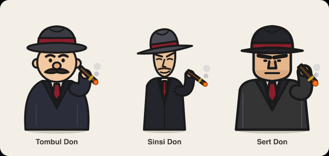
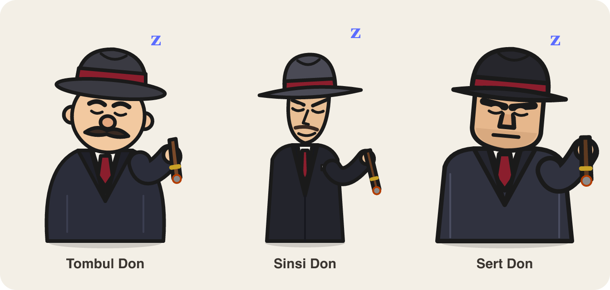
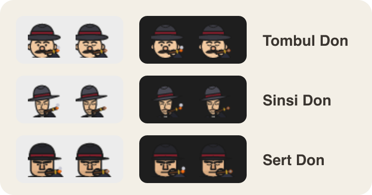

# keepmeawake

[](https://github.com/mustafaerbay/keepmeawake/actions/workflows/ci.yml)
[](https://github.com/mustafaerbay/keepmeawake/releases/latest)
<a href="https://buymeacoffee.com/mustafaerbay"></a>

<p align="center">
  
</p>

Bilgisayarı uyanık tutan, puro içen bir mafya babası. **Don purosunu içtiği sürece Mac'in ya da Windows PC'nin uykusu gelmez.** Puroyu söndürünce uyku düzeni normale döner.

- **Menü çubuğu / sistem tepsisi:** Minik bir Don ikonu. Puro yanıkken arada bir puf yapar, sönünce gözlerini kapatır.
- **Ekranda Don:** Şeffaf, hep üstte duran, sürüklenebilir bir karakter. Puroyu ağzına götürür, nefes çeker, dumanı üfler. Söndürünce uyuklar.
- **Üç tema:** Tombul Don (varsayılan), Sinsi Don, Sert Don.

Karakterler bu proje için özgün olarak çizildi. Hiçbir filmden, kişiden veya markadan alıntı içermez.

Puroyu söndürünce Don uyuklar; bilgisayar da normal uyku düzenine döner:

<p align="center">
  
</p>

Menü çubuğunda ve sistem tepsisinde Don böyle görünür (solda puro yanık, sağda sönük; açık ve koyu menü çubuğu):

<p align="center">
  
</p>

## Kurulum

[Releases](https://github.com/mustafaerbay/keepmeawake/releases/latest) sayfasından platformuna uygun dosyayı indir:

- **macOS** (Apple Silicon ve Intel): `keepmeawake_X.Y.Z_universal.dmg`. Aç ve uygulamayı `Applications` klasörüne sürükle.
- **Windows 10/11:** `keepmeawake_X.Y.Z_x64-setup.exe` ya da `.msi`.

### İlk açılışta güvenlik uyarısı

Paketler henüz Apple veya Microsoft tarafından imzalanmadı (notarize edilmedi). Uygulama güvenli, ama işletim sistemi ilk açılışta uyarı verir.

**macOS** — *"Apple could not verify “keepmeawake” is free of malware that may harm your Mac or compromise your privacy."* uyarısı çıkarsa:

1. Uyarıda **Done** de.
2. **Sistem Ayarları → Gizlilik ve Güvenlik** bölümünün en altına in, "keepmeawake" satırındaki **Yine de Aç** düğmesine bas ve şifreni gir.
3. Uygulamayı tekrar aç, çıkan uyarıda **Yine de Aç**'ı seç. Bunu bir kez yapman yeterli.

macOS 15 (Sequoia) ve sonrasında sağ tık → **Aç** artık bu uyarıyı geçmiyor; yukarıdaki yol gerekli. Terminal'i tercih edersen tek komut yeter:

```bash
xattr -dr com.apple.quarantine /Applications/keepmeawake.app
```

**Windows** — SmartScreen uyarısında **Ek bilgi** → **Yine de çalıştır**.

Sürümler arasındaki değişiklikler [CHANGELOG.md](CHANGELOG.md) dosyasında.

## Kullanım

| Ne | Nasıl |
|---|---|
| Puroyu yak / söndür | Don'a çift tıkla. Ya da menüden `🔥 Puroyu yak` / `💨 Puroyu söndür`. Windows'ta tepsi ikonuna sol tıkla. |
| Menü | macOS: menü çubuğundaki ikona tıkla. Windows: tepsi ikonuna sağ tıkla. |
| Don'u taşı | Sürükle. Konumu hatırlanır. |
| Don'u gizle | Menü → `Don'u gizle` (gizliyken animasyon tamamen durur). |
| Ekran kararsın ama sistem uyumasın | Menü → `Ekran kararabilir`. |
| Don tıklamaları engellemesin | Menü → `Don'a dokunulmasın` (tıklamalar Don'un içinden geçer). |
| İkon puf yapmasın | Menü → `Hareketli ikon` (kapalıyken ikon tamamen sabit) |
| Don'un boyutu | Menü → `Boyut` → Küçük / Orta / Büyük |
| Tema | Menü → `Tema` |
| Açılışta başlat | Menü → `Açılışta başlat` |
| Kahve ısmarla | Menü → `☕ Don'a kahve ısmarla` |

Uygulama her açılışta puro **yanık** başlar.

## Geliştirme

Gerekenler: Rust (stable), Node 20+, pnpm.

```bash
pnpm install
pnpm tauri dev          # uygulamayı geliştirme modunda çalıştırır
pnpm test               # ön yüz testleri (vitest)
cargo test --manifest-path src-tauri/Cargo.toml --lib   # Rust testleri
pnpm tauri build        # paket: src-tauri/target/release/bundle/
```

Animasyonları uygulama olmadan izlemek için `pnpm vite` çalıştırıp `http://localhost:1420/preview.html` adresini aç.

### Yeni tema eklemek

1. `themes/<id>/` klasörünü oluştur: `theme.json`, `character.svg`, `character.css`.
2. `character.svg` şu id'leri içermeli: `body`, `head`, `arm` (içinde `cigar`, `tip`, `wisps` → `flame`, `smoke-1..3`), `lids`, `puffs` → `smoke-4..5`, `zzz`. Animasyonun ortak kısmı `themes/_shared/smoker.css` dosyasında. Temanın CSS'i sadece dönme noktalarını (`--shoulder`, `--neck`, `--tip`) ve açıları verir.
3. `pnpm tray:render` komutu tepsi karelerini ve `src-tauri/src/tray_frames.rs` dosyasını yeniden üretir.
4. `pnpm readme:render` komutu README görsellerini (`docs/images/`) yeniden üretir.

## Sürüm çıkarma

1. [CHANGELOG.md](CHANGELOG.md) dosyasında `## [Unreleased]` altındakileri yeni sürüm başlığına taşı.
2. `package.json`, `src-tauri/Cargo.toml` ve `src-tauri/tauri.conf.json` içindeki sürümü güncelle.
3. Commit et ve etiketi push et:

   ```bash
   git tag v0.1.0 && git push origin v0.1.0
   ```

GitHub Actions ([release.yml](.github/workflows/release.yml)) önce etiketin dosyalardaki sürümle aynı olduğunu kontrol eder. Sonra macOS (universal) ve Windows paketlerini derler ve **taslak** bir release açar. Release notu CHANGELOG'daki ilgili bölümden alınır, sonuna kahve bağlantısı eklenir. Taslağı GitHub'da kontrol edip **Publish** ile yayınla.

## Destek

Don'u sevdiysen ona bir kahve ısmarlayabilirsin: [buymeacoffee.com/mustafaerbay](https://buymeacoffee.com/mustafaerbay). Aynı bağlantı uygulama menüsünde de var: `☕ Don'a kahve ısmarla`.

## Uykunun gerçekten engellendiğini doğrulama

- **macOS:** `pmset -g assertions | grep keepmeawake` komutunu çalıştır. Puro yanıkken `PreventUserIdleSystemSleep` satırı görünür; `Ekran kararabilir` kapalıysa `PreventUserIdleDisplaySleep` satırı da görünür. Puro sönünce satırlar kaybolur.
- **Windows:** Yönetici komut isteminde `powercfg /requests` çalıştır. Puro yanıkken SYSTEM (ve DISPLAY) altında görünür, sönünce kaybolur.

Kapak kapatma ve elle uyutma engellenmez. Bunlar işletim sisteminin kuralıdır.
